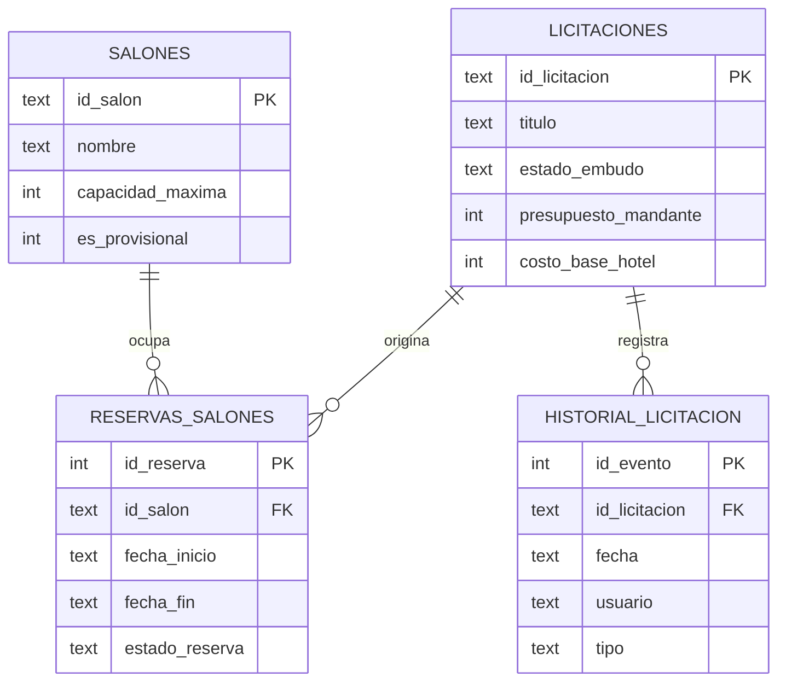

# Modelo Logico

Vista de entidades y relaciones del sistema (diagrama entidad-relacion).
Fuente de verdad: el esquema real de `database.py`.

## Diagrama

## Entidades independientes

| Entidad | Descripcion |
| :--- | :--- |
| `AJUSTES` | Parametros de negocio en esquema clave-valor (UTM, tope de Compra Agil, margen de tolerancia). No relaciona con otras entidades. |
| `HISTORIAL_OC` | Ordenes de compra historicas del hotel, cargadas desde un archivo Excel. Se usa solo para reportes por cliente clave; no referencia ni es referenciada. |

## Descripcion de las relaciones

| Relacion | Cardinalidad | Tipo | Naturaleza |
| :--- | :--- | :---: | :--- |
| `SALONES` → `RESERVAS_SALONES` | 1 a N | Fuerte (FK explicita) | Un salon tiene muchas reservas; cada reserva apunta a un salon existente. |
| `LICITACIONES` → `RESERVAS_SALONES` | 1 a N | Debil (sin FK) | Una licitacion puede generar varias reservas; la reserva guarda el codigo en `id_licitacion`. |
| `LICITACIONES` → `HISTORIAL_LICITACION` | 1 a N | Debil (sin FK) | Una licitacion acumula muchos eventos de bitacora. |

## Reglas de negocio asociadas

* **Colisiones de agenda:** dos reservas `Confirmada` del mismo salon no
  pueden solaparse en fechas. La validacion corre dos veces: en el formulario
  y dentro de la transaccion de escritura (`BEGIN IMMEDIATE`).
* **Embudo:** `estado_embudo` avanza Identificada → Calificada →
  Participada → Adjudicada; `Descartada` y `Cerrada` son estados de salida.
* **Eliminacion en cascada (a nivel de aplicacion):** borrar una licitacion
  borra su `HISTORIAL_LICITACION` y desvincula sus reservas en una sola
  transaccion SQLite.
* **Cierre automatico:** al entrar al tablero, las licitaciones con
  `fecha_cierre` pasada pasan de abiertas a `Cerrada`.
